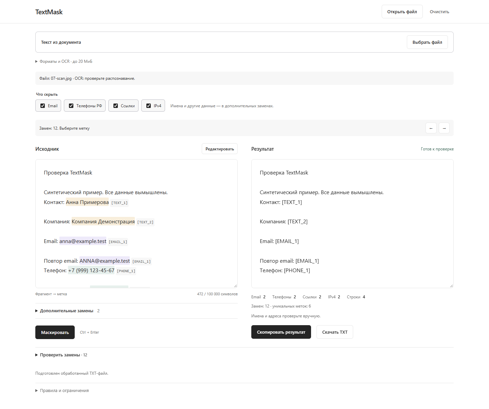
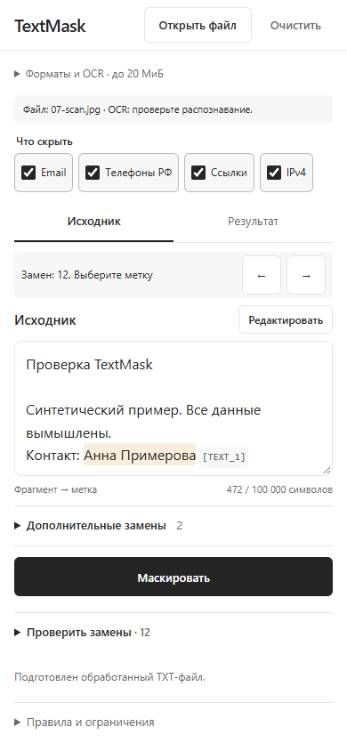
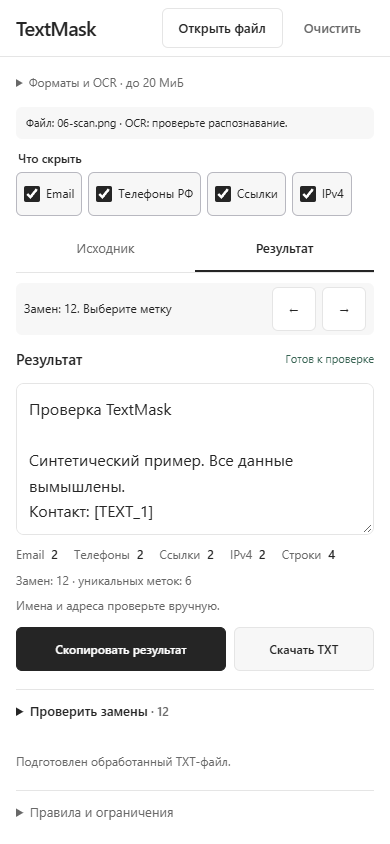

# TextMask

[](https://github.com/andreyqwerty365-netizen/textmask/actions/workflows/test.yml)
[](https://github.com/andreyqwerty365-netizen/textmask/releases/latest)
[](LICENSE)

Подготовьте текст или документ к передаче в ИИ: замените контакты и выбранные строки на постоянные метки, проверьте замены и скачайте TXT. Обработка выполняется на вашем компьютере, включая распознавание сканов.

**[Скачать для Windows](https://github.com/andreyqwerty365-netizen/textmask/releases/latest) · [Что нового в 2.0](CHANGELOG.md) · [Примеры файлов](examples/TextMask-test-files.zip)**



## Запуск за минуту

1. На [странице релиза](https://github.com/andreyqwerty365-netizen/textmask/releases/latest) скачайте **TextMask-2.0.0-windows-x64.zip** из Assets.
2. Распакуйте **весь архив** в любую удобную папку.
3. Откройте **TextMask.exe** — интерфейс появится в браузере.

Node.js уже внутри. Установка, терминал, права администратора и интернет для работы не нужны. Требуются Windows 10/11 x64 с .NET Framework 4.8 и современный браузер; рекомендуется Edge или Chrome. Сборка проверена в Windows 11 x64; отдельная проверка на Windows 10 ещё не выполнена.

Закрытие вкладки очищает ввод, но оставляет сервер работающим. Значок TextMask в системном трее позволяет снова открыть интерфейс или выбрать **«Остановить и выйти»**. Повторный запуск EXE открывает уже работающий экземпляр. Если браузер не открылся, перейдите на [127.0.0.1:4175](http://127.0.0.1:4175/).

EXE не подписан сертификатом издателя, поэтому Windows может показать предупреждение. Скачивайте сборку из этого репозитория; контрольные суммы опубликованы в `SHA256SUMS.txt`. Не переносите EXE отдельно от папок `app` и `runtime`.

## Как пользоваться

1. Вставьте текст или нажмите **«Открыть файл»**. На компьютере файл также можно перетащить в редактор.
2. Выберите, что скрыть. Email и российские телефоны включены по умолчанию; ссылки и IPv4 включаются отдельно.
3. При необходимости раскройте **«Дополнительные замены»**: например, имя или название компании, по одной точной строке на строку.
4. Нажмите **«Маскировать»** и проверьте исходник с подсветкой и список **«Проверить замены»**.
5. Скопируйте результат или скачайте обработанный TXT.

```text
Напишите Анне: anna@example.test, +7 (999) 123-45-67.
Повторный контакт: ANNA@example.test.
                       ↓
Напишите Анне: [EMAIL_1], [PHONE_1].
Повторный контакт: [EMAIL_1].
```

Одинаковые значения получают одинаковую метку. Форматирование телефона и регистр email не создают новые метки. Ручные строки ищутся буквально, с учётом регистра, без регулярных выражений. Пересекающиеся совпадения объединяются целиком, чтобы не оставлять открытые части; приоритет: URL → EMAIL → PHONE → IP → TEXT. Существующие метки в исходнике резервируются.

## Файлы и OCR

| Вход | Как читается | Результат |
| --- | --- | --- |
| TXT, MD | Текст в UTF-8, включая BOM | Обработанный TXT |
| DOCX | Текст документа, без исполнения макросов | Обработанный TXT |
| PDF с текстом | Извлечение текста страниц | Обработанный TXT |
| PDF-скан | Рендеринг страниц и локальное OCR | Обработанный TXT |
| PNG, JPG, JPEG | Локальное OCR на русском и английском | Обработанный TXT |

В PDF страницы без извлекаемого текста распознаются автоматически. При необходимости можно включить принудительное OCR всего PDF. Для OCR видны имя файла, этап, страница и реальный процент распознавания текущей страницы. Операцию можно отменить; частичный результат не заменит текущий текст. Подсказки словаря помогают распознавать обозначения `IPv4` и `IPv6`.

Исходный файл остаётся неизменным. Выход всегда **обычный UTF-8 TXT**: изображения, таблицы и оформление документа не сохраняются. Поддерживается один файл за раз, до **20 МиБ**, до **30 страниц PDF** и до **100 000 символов** текста (UTF-16). Старые `.doc`, зашифрованные PDF, архивы и пакетная обработка не поддерживаются.

В [наборе примеров](examples/TextMask-test-files.zip) есть семь файлов, ручные правила и ожидаемые результаты. Все данные вымышлены. Базовые настройки дают **4 замены / 2 метки**; все четыре автоматических правила и две ручные строки — **12 замен / 6 меток**.

## Удобная проверка

- Выделенные фрагменты связаны с метками; стрелки переходят между вхождениями, список показывает число повторов и страницы по 20 меток.
- Изменение текста или правил отключает копирование и скачивание старого результата до повторной обработки.
- Замена уже введённого текста файлом требует подтверждения. Очистка сбрасывает ввод, правила и результат.
- На компьютере исходник и результат расположены рядом; на узком экране — во вкладках. Компактные поля прокручиваются внутри, основные кнопки остаются рядом с текстом.
- Клавиатура: `Ctrl+Enter` / `⌘+Enter` запускает обработку, стрелки/Home/End переключают мобильные вкладки, видимый фокус помогает навигации.

 

## Приватность и границы

Текст и файлы обрабатываются в памяти вкладки и локальных workers. Сервер слушает только `127.0.0.1`, отдаёт разрешённые ресурсы и принимает только GET/HEAD. Документы ему не отправляются. CDN, аналитики, аккаунтов, облачных API и истории нет. Приложение не записывает ввод в cookies, localStorage, sessionStorage, IndexedDB или журналы. Модели OCR поставляются локально и не кэшируются в IndexedDB.

После перезагрузки/закрытия страницы ввод очищается. Скопированный текст попадает в системный буфер обмена, скачанный TXT сохраняется браузером на диск. Расширения браузера и доступ других людей к компьютеру находятся вне защиты TextMask.

Маскировка — помощник для ручной проверки, **не гарантия полного обезличивания и не шифрование**. Имена, адреса, номера документов и произвольные секреты автоматически не определяются: добавляйте точные строки вручную. OCR может ошибаться, особенно на нечётких изображениях, рукописном тексте и сложной вёрстке. Проверяйте распознавание до обработки и итог перед отправкой.

## Исходники и самостоятельная сборка

HTML, CSS, обычный JavaScript и Node.js 24. Без `npm install`:

```sh
npm start
npm test
npm run check
```

Откройте [локальный интерфейс](http://127.0.0.1:4175/); остановка сервера — `Ctrl+C`. Открытие `index.html` через `file://` не поддерживается. Linux и macOS используют этот способ запуска; готовая оболочка выпускается для Windows x64.

```powershell
npm run build:windows
```

Сценарий скачивает официальный Node.js с проверкой закреплённого SHA-256, компилирует открытый исходник EXE штатным C#-компилятором Windows и создаёт ZIP в `dist/`. В готовом ZIP есть инструкции, примеры, лицензии, сведения о сборке и хеши файлов. Подробнее: [сборка и устройство оболочки](docs/BUILD.md), [проверки](docs/TESTING.md).

Приложение — [MIT](LICENSE). Локальные библиотеки и Node.js распространяются со своими лицензиями: [THIRD_PARTY.md](THIRD_PARTY.md). Визуальный ориентир — Tiptap Simple Editor; оформление реализовано самостоятельно, без кода Tiptap и дополнительных шрифтов: [происхождение дизайна](docs/DESIGN.md).
